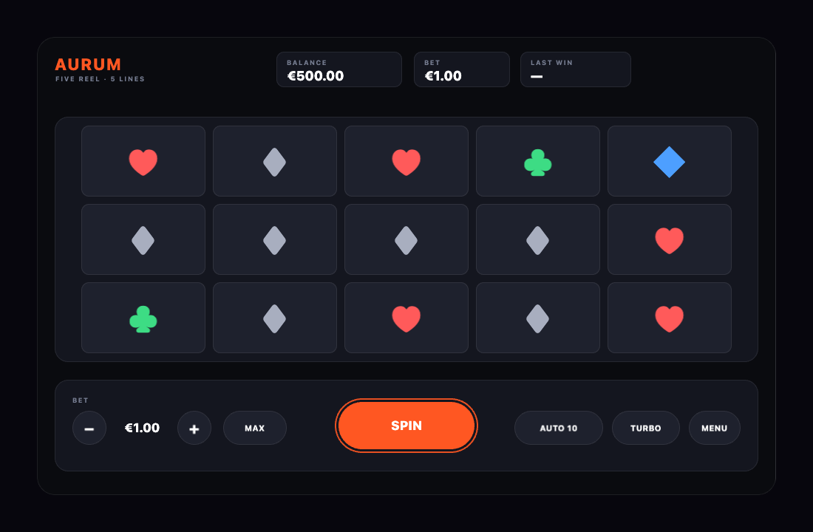

# pixi-slot-hud

A five-reel, five-line slot and its HUD, drawn entirely with PixiJS. There isn't a single image or sprite in it: symbols are glyphs on rounded tiles, so it loads instantly and has no assets to manage.



**Live:** [popzify.com/ui/hud](https://popzify.com/ui/hud), embedded in the case study it was built for.

## Why it exists

The colours, radii and spacing come from the design tokens of [Correct Score Pro](https://popzify.com/ui), a React Native app, converted to hex numbers because Pixi doesn't take CSS strings. The point was to show that a token system doesn't depend on what draws it: the same numbers give the same look in the DOM and on a WebGL canvas.

## What works

- Weighted reels: each symbol has its own frequency, so a 7 is rare and a ♦ is common.
- Five paylines checked left to right, the way real machines pay: three, four or five of a kind from the first reel.
- Bet ladder from €0.20 to €100, balance checks before every spin, autoplay ×10, turbo.
- A menu drawer with three tabs: paytable (built from the same data the game uses), settings and spin history.
- Full keyboard control. Pixi draws on a canvas and has no DOM focus, so focus is kept in a list by hand: arrows move it, Enter or Space presses, Esc closes the drawer. It works like a gamepad menu.
- The scene is laid out in a fixed 1000×620 logical frame and scaled into whatever space it gets.

The game is made up and plays with fake money, but the rules are real: payouts, odds and the balance work exactly as written in `src/hud.ts`.

## Run it

```bash
npm install
npm run dev
```

`npm run build` type-checks and builds a static site into `dist/`.

## Files

- `src/hud.ts`: tokens, symbols with weights and payouts, paylines, the draw and the win check
- `src/scena.ts`: the Pixi scene, input handling and animation, plus a cleanup function that destroys everything it created
- `src/main.ts`: mounts the scene

Identifiers and comments are in Serbian (*scena* = scene, *dobos* = reel, *ulog* = bet, *dobitak* = win).

## License

MIT
